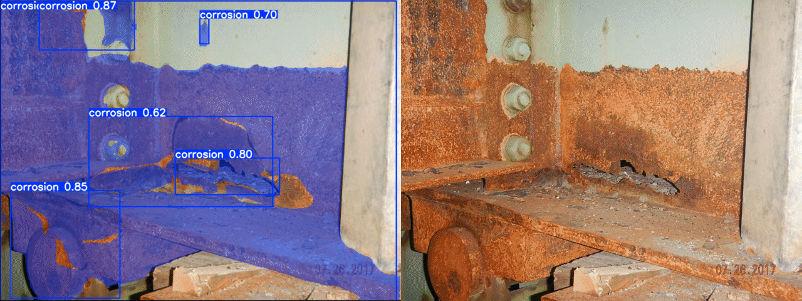
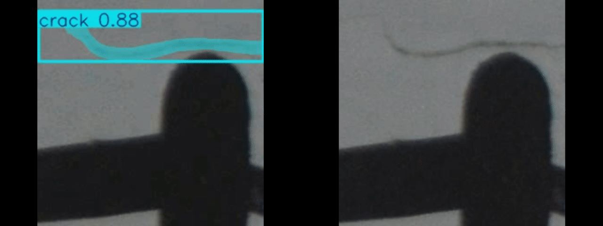
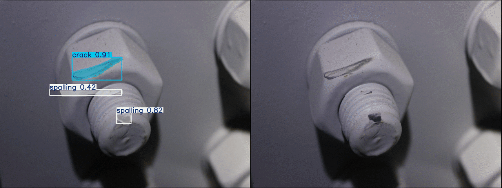

# Surface Defects Segmentation on phyBOARD-Pollux

Real-time surface defect segmentation (corrosion, crack, coating spalling) using **YOLOv8n-OSRA**, exported to a full-integer-quantized (INT8) TFLite model and run on the **phyBOARD-Pollux** (NPU via the VX delegate) or any CPU with a TFLite runtime.

## Results

Side-by-side comparisons for each defect class:

### Corrosion


### Crack


### Coating spalling


## Model

- **Architecture:** YOLOv8n-OSRA (YOLOv8n-seg based instance segmentation)
- **Classes:** `corrosion`, `crack`, `Coating spalling`
- **Format:** full-integer-quantized TFLite — `best_saved_model/best_full_integer_quant.tflite`
- **Input:** int8 `[1, 640, 640, 3]`
- **Outputs:**
  - `[1, 39, 8500]` — 4 box values + 3 class scores + 32 mask coefficients
  - `[1, 160, 160, 32]` — mask prototypes

## Dataset

The model was trained on the surface defects dataset:
[surface defects.zip](https://hnueducn-my.sharepoint.com/:u:/r/personal/zwliu_hnu_edu_cn/Documents/%E8%AE%BA%E6%96%87%E4%BF%AE%E6%94%B9/surface%20defects.zip?d=wa84b09a51ba44904bfd3726a711d88f7&csf=1&web=1&e=H1IItF)

## Project structure

```
.
├── main.py                                   # webcam inference script
├── best_saved_model/
│   └── best_full_integer_quant.tflite        # INT8 quantized model
└── results/
    ├── corrosion_comparison.gif
    ├── crack_comparison.gif
    └── spalling_comparison.gif
```

## Installation

```bash
pip install opencv-python numpy tflite-runtime 
```

## Usage

```bash
# CPU
python main.py --model best_saved_model/best_full_integer_quant.tflite

# NPU (default delegate: /usr/lib/libvx_delegate.so)
python main.py --npu

# Custom delegate
python main.py --delegate /path/to/other_delegate.so
```

| Option | Default | Description |
|---|---|---|
| `--model` | `best_saved_model/best_full_integer_quant.tflite` | Path to the TFLite model |
| `--camera` | `0` | Camera index |
| `--conf` | `0.25` | Confidence threshold |
| `--iou` | `0.45` | NMS IoU threshold |
| `--threads` | `4` | CPU threads |
| `--no-mask` | off | Boxes only (faster) |
| `--npu` | off | Use the NPU delegate |
| `--delegate` | – | Path to a delegate `.so` (implies `--npu`) |

**Keys:** `q` / `ESC` quit, `m` toggle masks.

> The first inference on the NPU compiles the graph and can take several seconds.

## References

- [SIFT-Bolt](https://github.com/JunlongCode/SIFT-Bolt) — reference repository
- YOLOv8 / Ultralytics
